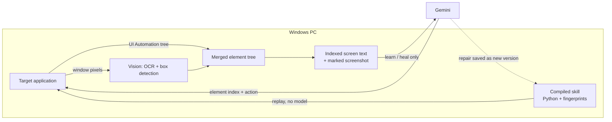
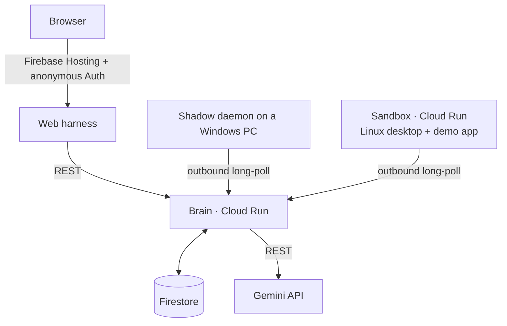

<div align="center">

# Shadow

**Teach a computer task once. Replay it as code at RPA speed. Let Gemini repair it when the application changes.**

[](LICENSE)


</div>

---

## Overview

Shadow is a desktop automation engine for Windows. An AI agent performs a task once while Shadow records it; Shadow then compiles the recording into a readable Python skill that replays with **no model calls**. When a later run fails because the interface changed, Gemini is asked about that one step only, the repair is validated, saved as a new version, and the run continues.

Shadow works on any window: native desktop applications, web pages in any Chromium browser, and surfaces with no accessible structure at all, such as remote-desktop viewers, canvases and whiteboards. It achieves this by merging two sources into a single element tree: the operating system's UI Automation tree and computer vision on the window's own pixels.

Built for the **Google Cloud AI Builder Cup 2026**, theme *Future of Work & Enterprise Productivity*.

| | First run (Gemini) | Every run after (compiled skill) |
|---|---|---|
| 4-step invoice entry | ~14 s, 5 model calls | **~0.55 s, 0 model calls** |
| After the UI changes | 2 model calls to repair, saved as v2 | back to 0 model calls |

## Contents

- [Key capabilities](#key-capabilities)
- [How it works](#how-it-works)
- [Getting started](#getting-started)
- [Usage](#usage)
- [Architecture on Google Cloud](#architecture-on-google-cloud)
- [Performance](#performance)
- [Testing](#testing)
- [Security and safety](#security-and-safety)
- [Project structure](#project-structure)
- [Project status and limitations](#project-status-and-limitations)
- [Related work](#related-work)
- [License](#license)

## Key capabilities

**Understands any window as text a model can act on.** Every element gets an index, role, label, current value, state and the actions it accepts. The model never handles pixels or coordinates; it answers with an index.

```
WINDOW "Invoice Entry - Acme ERP" (erp.exe) | snapshot: 7 | focused: [1] | dialog: none | 14 elements, 83 ms
[1] input "Invoice No" = "" (focused)  actions: type
[3] dropdown "Vendor" = "Select..."  actions: select
[6] checkbox "Tax inclusive" (unchecked)  actions: click, toggle
[7] button "Save"  actions: click
[12] region (no tree, read by CV, 802x328 px)  actions: click_at, drag
  [13] button "Rectangle" (at 112,125, cv 1.00)  actions: click
```

**Compiles every taught task into code.** Typed and selected values become parameters; each step carries a post-condition.

```python
def run(h, invoice_no='INV-1042', vendor='Contoso Supplies', amount='1200'):
    # Enter the invoice number
    h.type(el("inp_invoice_no"), invoice_no)
    # Choose the vendor
    h.select(el("dd_vendor"), vendor)
    # Enter the amount
    h.type(el("inp_amount"), amount)
    # Save the invoice
    h.click(el("btn_save"), expect=f'text:Saved {invoice_no}')
```

**Operates every common form control, on the web and on the desktop.** Text, password, email, number, date, multi-line text, fixed and editable dropdowns, multi-select lists, radio buttons, checkboxes, sliders, number spinners, switches and tabs. Legacy WinForms and Win32 controls that only expose MSAA are driven with real clicks and keystrokes, because they accept automation calls without notifying the application.

**Extracts structured data.** Tables (HTML tables, WinForms DataGridView, Explorer-style details lists) and repeated items (product cards, search results, tiles, desktop card panels), following *Next* pages and infinite scroll, with CSV export.

**Acts like a person.** Click with Ctrl, Shift or Alt held, double and triple click, right click, hover, drag one element onto another, drag and click on a canvas, type, keyboard shortcuts and scrolling. Elements out of view are scrolled into view first.

**Draws on whiteboards.** `shadow draw "<description>"` has Gemini plan a diagram of boxes and arrows, draws it with the board's own tools, then reads the canvas back to confirm every label.

**Gives the model real screen context.** Alongside the indexed text, Gemini receives a screenshot with every element boxed and numbered whenever part of the window is read from pixels.

**Heals safely.** Repairs are validated before use, limited to two attempts, versioned with diffs and rollback, and never applied to irreversible steps or business-rule failures.

## How it works



1. **One merged tree.** The UI Automation tree is fetched in a single cached call. Where it is complete, nothing else runs. Where it is not, vision fills in: unnamed controls are named from the text drawn on them, input-shaped surfaces become inputs, and regions with no tree become `region` elements whose content is detected from pixels. Text the tree already explains is dropped, so nothing appears twice.
2. **Efficient vision.** Only areas the tree cannot describe are read, using the window's own rendering so overlapping windows do not interfere. After the first pass only changed pixels are re-read; carets are erased and small text is enlarged before OCR.
3. **Fingerprints, not selectors.** Each step stores several independent ways to find its element: automation ID, role and name, label, ancestor path, neighbours and relative position. A match is accepted only when a second property agrees. Duplicates are told apart by position; anything ambiguous is refused, never guessed.
4. **Post-conditions.** Steps that save or submit carry an expected result taken from what actually appeared when the task was taught. A check that was already true before the step does not count.
5. **Validated healing.** A failed step produces a packet with its intent, original fingerprint, the current screen and the failure reason. The healer may retarget, correct the expected wording, or escalate; its answer must pass validation before it is applied.

## Getting started

### Requirements

- Windows 10 or 11
- Python 3.11 or newer
- A Gemini API key from [Google AI Studio](https://aistudio.google.com/) (for learning, healing and diagram planning; replay needs no key)

### Install

```bash
git clone https://github.com/SonuSV7719/Computer_Automate_Agent_Harness.git
cd Computer_Automate_Agent_Harness
python -m venv .venv
.venv\Scripts\activate
pip install -e ".[dev]"
pip install rapidocr-onnxruntime opencv-python-headless numpy
```

### Configure

Create `%USERPROFILE%\.shadow\.env`:

```ini
GEMINI_API_KEY=your-key
# Optional
SHADOW_GEMINI_MODEL=gemini-3.5-flash-lite   # use gemini-3.8-flash with a billed key
SHADOW_ALLOW=erp.exe,chrome.exe             # restrict Shadow to these applications
SHADOW_SCREENSHOTS=auto                     # auto | always | never
```

The local daemon starts automatically on the first command.

## Usage

### Read and act

```bash
shadow windows                                   # list open windows
shadow target "Invoice"                          # choose one by title or process
shadow see                                       # read it as indexed text
shadow act 1 type "INV-1042" --intent "Enter the invoice number"
shadow act 7 click --expect "text:Saved INV-1042" --intent "Save the invoice"
```

### Teach once, replay as code

```bash
# Let Gemini perform the task once and compile it
shadow learn "Enter invoice INV-1042 for Contoso Supplies, amount 1200, then save it." --name enter_invoice

# Or record your own commands
shadow record start
shadow record save enter_invoice

# Replay with new data: no model calls
shadow run enter_invoice -p invoice_no=INV-2001 -p amount=75
```

### Extract data

```bash
shadow table --next "Next" --csv orders.csv          # every row of a paged table
shadow items --next "Next page" --csv products.csv   # product cards across pages
shadow items 39 --scroll                             # a list that grows as you scroll
```

### Draw a diagram

```bash
shadow target "Excalidraw"
shadow draw "architecture of a ride-sharing app"
shadow draw --spec diagram.json                  # or supply the boxes and arrows yourself
```

### Command reference

| Command | Purpose |
|---|---|
| `shadow windows` / `target <query>` | List windows; choose the one to work on |
| `shadow see` | The window as indexed text |
| `shadow act <index> <action> [value]` | One action, with `--expect` and `--intent` |
| `shadow key <combo>` / `text "<string>"` | Press keys / type into whatever has focus |
| `shadow learn "<goal>" --name <skill>` | Gemini performs the task once; it is compiled |
| `shadow record start` / `record save <skill>` | Record your own actions and compile them |
| `shadow run <skill> -p name=value` | Replay with no model; `--heal auto\|host\|off` |
| `shadow heal <run> --index N \| --expect … \| --escalate …` | Answer a paused run |
| `shadow skills list\|code\|diff\|rollback` | Manage skills and their versions |
| `shadow table` / `items` | Extract tables or repeated items (`--next`, `--scroll`, `--csv`) |
| `shadow draw "<description>"` | Plan and draw a diagram on a whiteboard |
| `shadow extract <skill> <file>` | Read a document into a skill's inputs |
| `shadow runs` / `status` | Recent runs; daemon, pairing and Gemini status |
| `shadow pair <code> --url <brain>` | Connect this PC to the web harness |
| `shadow stop` / `resume` | Kill switch |

Actions: `click`, `doubleclick`, `rightclick`, `tripleclick`, `hover`, `drag_to`, `type`, `append`, `select`, `set`, `toggle`, `expand`, `collapse`, `focus`, `scroll`, `click_at`, `drag`. Exit codes: `0` ok, `1` error, `2` expected result not seen, `3` stale snapshot, `4` run paused for a repair, `5` run needs a person, `6` stopped.

### Use from other AI agents

[`skills/shadow/SKILL.md`](skills/shadow/SKILL.md) teaches any agent that can run shell commands (Antigravity, Gemini CLI, Claude Code, OpenCode) to drive Shadow: the read-act-check loop, the screen format, recording, extraction, drawing and how to answer a paused run.

## Architecture on Google Cloud



| Service | Role |
|---|---|
| **Gemini** | Learns a task one indexed element at a time, repairs failed steps from their intent and the current screen (with a marked screenshot when useful), plans diagrams, and reads documents into skill inputs. Never called during replay. |
| **Cloud Run** | Runs the brain, the only holder of the Gemini key, and the sandbox, a Linux desktop the agent drives so the prototype can be tried with no installation. |
| **Firestore** | Stores skills with every version and repair, runs with timing and model-call counts, paired devices, and the command queue between the web harness and each agent. Browsers never access it directly. |
| **Firebase** | Hosts the web harness and signs visitors in anonymously. |

Agents connect outbound only; the cloud never reaches into a machine. Screenshots stay on the PC except when sent to Gemini for learning or repair.

To deploy, follow the manual steps in the header of [`deploy/deploy.sh`](deploy/deploy.sh), then run it. To run the whole stack locally:

```bash
python -m brain.local                              # brain on :8090 with in-memory storage
python -m http.server 8099 -d dashboard/public     # web harness on :8099
shadow pair <code from "Pair a PC"> --url http://127.0.0.1:8090
```

## Performance

Measured with the live test scripts on a 12-core Windows 11 laptop at 125% display scaling.

| Operation | Result |
|---|---|
| Read a window through the UI tree | 60–100 ms |
| One action through the UI tree | 6–140 ms |
| Replay a 4-step skill (tree-backed application) | 0.53–0.69 s, 0 model calls |
| Replay a 4-step skill (application with no element names, vision) | 1.8–3.7 s, 0 model calls |
| Gemini learns a 4-step task from one sentence | 11–14 s, 5 model calls |
| Gemini learns a browser form plus a canvas drawing | 16–24 s, 6 model calls; replay 1.3–1.8 s |
| Gemini repairs a changed UI (2 controls renamed and moved) | ~5 s, 2 model calls; next replay 0 calls |
| Paged table, 23 rows over 3 pages (web / desktop grid) | 3.4 s / 0.5 s |
| Product cards over 3 pages (web, 18 / desktop, 14) | 3.7 s / 1.7 s |
| Infinite-scroll list, 40 entries | 24 s |
| books.toscrape.com, 60 books over 3 pages | 21 s, mostly page loading |

## Testing

```bash
pytest                                         # 103 unit tests; any OS, no desktop needed
bash tests/live/run_live.sh                    # WinForms app: record, replay, UI change, repair, exception
bash tests/live/run_live_cv.sh                 # Tk app with no element names: the vision path end to end
bash tests/live/run_live_stack.sh              # web harness -> brain -> paired agent -> real application
bash tests/live/run_live_gemini.sh             # real Gemini: learn, replay, repair, exception, document
bash tests/live/run_live_excalidraw.sh         # excalidraw.com: draw, label, find the object from pixels, click it
bash tests/live/run_live_excalidraw_dupes.sh   # look-alike and duplicate objects
(cd dashboard && firebase emulators:exec --only firestore --project demo-shadow "python -m pytest ../tests/test_store.py")
```

The live scripts drive real windows with the real mouse and keyboard; run them when the machine is otherwise idle.

## Security and safety

- **Kill switch.** `shadow stop`, or <kbd>Ctrl</kbd>+<kbd>Alt</kbd>+<kbd>F12</kbd> anywhere, blocks every action immediately.
- **Application allowlist.** `SHADOW_ALLOW` restricts which applications Shadow may read or operate.
- **Passwords.** Masked fields are shown as `••••`; typed secrets are never written to recordings or skills.
- **Irreversible steps.** Payments, postings, sends and deletions are never repaired automatically.
- **No silent failures.** Unmet post-conditions stop the run; ambiguous matches are refused.
- **Least exposure.** The Gemini key lives only on the brain or in a local `.env`; Firestore rules deny all browser access.

## Project structure

```
shadow/            the agent: daemon, CLI, engine, replay runner, learning, extraction, drawing
  core/            element model, screen text, fingerprints, post-conditions, skills
  cv/              OCR, incremental reading, box detection, merging vision into the tree
  drivers/         Windows (UI Automation, MSAA, input) and Linux (X11, pixels)
  llm/             Gemini client and prompts for learning, repair, extraction
brain/             Cloud Run API: pairing, command relay, Gemini proxy, Firestore store
dashboard/         web harness (static, Firebase Hosting) and Firestore rules
sandbox/           Linux desktop image and the demo application for the cloud sandbox
skills/shadow/     SKILL.md for other AI agents
deploy/            Cloud Build configuration and deployment script
tests/             unit tests, fixtures, test applications and live end-to-end scripts
```

## Project status and limitations

Shadow is a hackathon prototype under active development.

**Verified on real software:** reading, acting, recording, compiling, replay and repair on WinForms, Tk and Chrome; every web and desktop form control listed above; table and item extraction with paging and scrolling on test applications and books.toscrape.com; learning and repair with real Gemini; drawing, labelling and selecting objects on excalidraw.com, and whole diagrams planned by Gemini from one sentence (8 boxes and 8 arrows, every label verified); hover menus, HTML drag and drop, triple click, Ctrl+click, right-click menus and double click; the web harness driven end to end.

**Not yet verified:** deployment to Google Cloud and the sandbox container end to end; reading PDFs and images through the web harness.

**Known limitations:**

- Windows is the primary platform. Linux (X11) is supported as pixels only, for the sandbox; macOS is not supported.
- OCR can misread small text. OCR-read text is matched with look-alike characters folded together, and each such element reports its confidence.
- Vision detects inputs, buttons, labelled checkboxes and text, but does not name icons without text; an unlabelled shape on a canvas is reachable by position only.
- Windows must not be minimised, and elements read only from pixels are operated with the real mouse.
- Elevated windows require the daemon to run as administrator; the Windows secure desktop cannot be automated.
- Infinite-scroll extraction is slow (about 2.5 s per scroll that loads nothing).

## Related work

Shadow combines ideas that exist separately: Microsoft UFO² fuses UI Automation with vision; Stagehand caches browser actions and self-heals; Cua provides sandboxes and drivers. Shadow's contribution is the combination across the whole desktop: one merged tree, compilation to readable code with multi-signal fingerprints, versioned and validated repair, canvas and remote-desktop handling, structured extraction, and a measured reduction in model calls.

### Third-party software

comtypes (MIT), FastAPI (MIT), Uvicorn (BSD-3-Clause), mss (MIT), Pillow (MIT-CMU), NumPy (BSD-3-Clause), OpenCV (Apache-2.0), ONNX Runtime (MIT), RapidOCR with PP-OCR models (Apache-2.0), google-cloud-firestore (Apache-2.0), firebase-admin (Apache-2.0). No AGPL-licensed components are used.

## License

Released under the [MIT License](LICENSE). Copyright © 2026 Sonu Vishwakarma.
